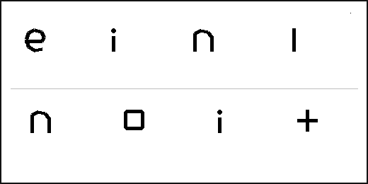

# Examples

The repository includes eight synthetic input fixtures and seven standalone scripts. Each fixture is regenerated deterministically from `examples/rasterregions_examples/generate_assets.py`.

Run the complete bundle from the repository root:

```bash
python examples/rasterregions_examples/run_all_examples.py
```

The runner prepares the inputs and writes outputs under the ignored `build/rasterregions_examples/` directory. Logs and output images are disposable. They are not committed as source evidence and are not included in the package wheel.

The first fixture illustrates sparse objects in two rows with a gray guide rule and an isolated noise pixel:



The examples cover:

1. Automatic multi-row detection, reading order, cleanup, and diagnostics.
2. Exact expected-count partitioning.
3. Colored foreground with gray worksheet guides.
4. Dark ink on shaded paper.
5. Connected components and anchor-based isolation.
6. NumPy image input.
7. Sparse mixed black and color content, grayscale quantization, touching objects, and one-region partitioning.

Run one script directly from the repository root, for example:

```bash
python examples/rasterregions_examples/example_01_auto_regions.py
```

The eighth asset, `08_single_region.png`, is available for single-region experiments. For fixture descriptions and setup details, see `examples/README.md` in the repository root.
